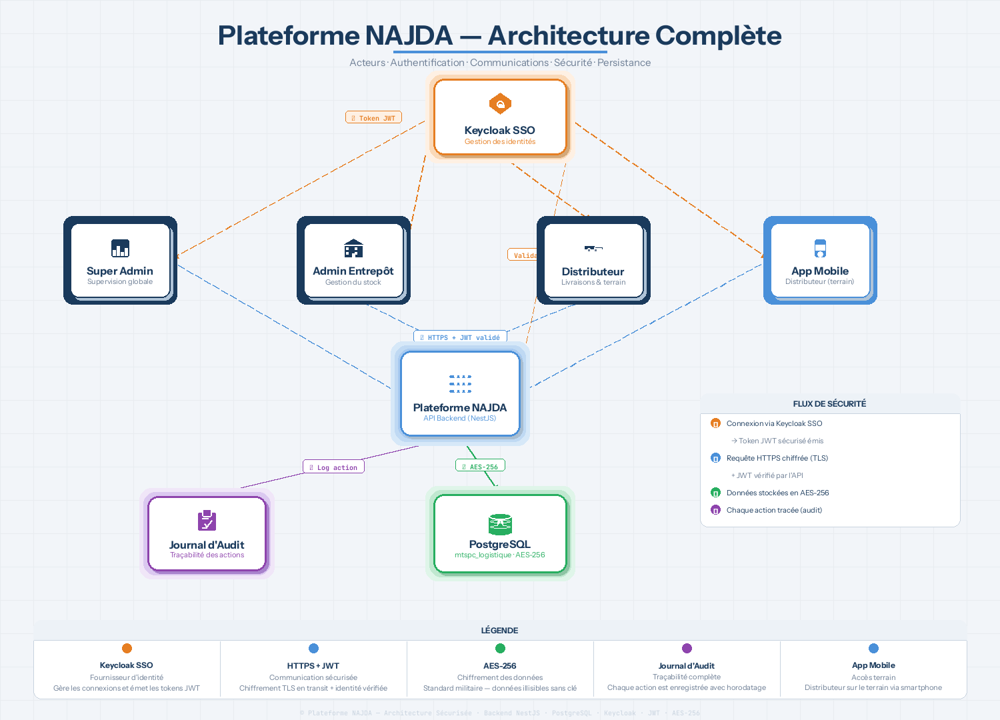

<div align="center">

# NAJDA

**Secure & intelligent humanitarian distribution platform**

Decision support for aid logistics after natural disasters in Morocco:
which villages to serve first, and how to reach them with the fewest kilometres.

Built for the **Moroccan TSP Competition (MTSPC26)** · ENSA Béni Mellal


</div>

---

## The problem

After the Al Haouz earthquake and the Béni Mellal-Khénifra floods, aid had to reach
hundreds of isolated *douars* (villages) with a limited fleet, limited stock and damaged roads.
Deciding **who gets served first** and **in which order trucks should drive** was mostly done by hand.

NAJDA turns that into a reproducible, auditable decision pipeline.

## How it works

```
 Census data (2,485 douars, HCP 2024)
            │
            ▼
 ┌──────────────────┐   ┌──────────────────┐   ┌──────────────────────────┐
 │ 1. AHP           │ → │ 2. TOPSIS        │ → │ 3. Multi-depot VRP       │
 │ weight criteria  │   │ rank the douars  │   │ build delivery routes    │
 │ (consistency CR) │   │ by priority      │   │ (Google OR-Tools)        │
 └──────────────────┘   └──────────────────┘   └──────────────────────────┘
            │                                              │
            └──────────── immutable audit trail ───────────┘
```

| Stage | What it does | Where |
|---|---|---|
| **AHP** | Weights 4 criteria (vulnerability, severity, accessibility, access to care) from pairwise comparisons and checks consistency (CR = 0.043) | `backend/src/algorithmes/ahp.service.ts` |
| **TOPSIS** | Ranks every douar by closeness to the ideal solution | `backend/src/algorithmes/topsis.service.ts` |
| **VRP** | Multi-depot vehicle routing solved with OR-Tools (Python, called from NestJS) | `backend/src/algorithmes/vrp.service.ts`, `backend/python/vrp_solver.py` |

**Results:** routing cost **-16.5 %** vs a greedy baseline (268 km vs 312 km), full decision cycle in **under 4 minutes**.

## Architecture

<p align="center"></p>

| Part | Stack | Folder |
|---|---|---|
| **Backend API** | NestJS, TypeORM, PostgreSQL, Socket.IO (live supervision), Swagger | `backend/` |
| **Web dashboard** | React + Vite, Leaflet maps, role-based admin & super-admin views | `mtspc-web/` |
| **Field app** | Expo / React Native, offline-first, GPS tracking, biometric login | `mtspc-mobile/` |
| **Identity** | Keycloak SSO (OIDC), RBAC per role | `keycloak/` |
| **Data** | PostgreSQL schema + HCP 2024 douars dataset | `database/`, `data/` |

Security by design: Keycloak SSO with JWT validation (JWKS), role-based access,
biometric unlock on mobile, and an **append-only audit trail** of every decision.
Detailed diagrams live in [`diagrams/`](diagrams/).

## Run it locally

Requirements: Docker, Node.js 20, Python 3 with `ortools`, Expo Go (for the mobile app).

```bash
# 1. Infrastructure (each folder: copy the template, then set your own passwords)
cd keycloak && cp .env.example .env && docker compose up -d && cd ..
cd database && cp .env.example .env && docker compose up -d && cd ..

# 2. Backend  → http://localhost:9090/api/v1  (Swagger: /api/docs)
cd backend && cp .env.example .env && npm install && npm run start:dev

# 3. Web dashboard  → http://localhost:3000
cd mtspc-web && cp .env.example .env && npm install && npm run dev

# 4. Mobile app (create mtspc-mobile/.env as in LAUNCH_GUIDE.md, then scan the QR code with Expo Go)
cd mtspc-mobile && npm install && npx expo start
```

Keycloak realm setup (one time, ~10 min): see [`keycloak/KEYCLOAK_SETUP.md`](keycloak/KEYCLOAK_SETUP.md).
Full step-by-step guide: [`LAUNCH_GUIDE.md`](LAUNCH_GUIDE.md).

## Team

- **Azddine El Hamdaoui** — [@azddine123](https://github.com/azddine123)
- **Youssef Ait Karroum** — [@YOUSSEFKARROUM](https://github.com/YOUSSEFKARROUM)

Supervised by Pr. Ennahbaoui · ENSA Béni Mellal, Université Sultan Moulay Slimane.
